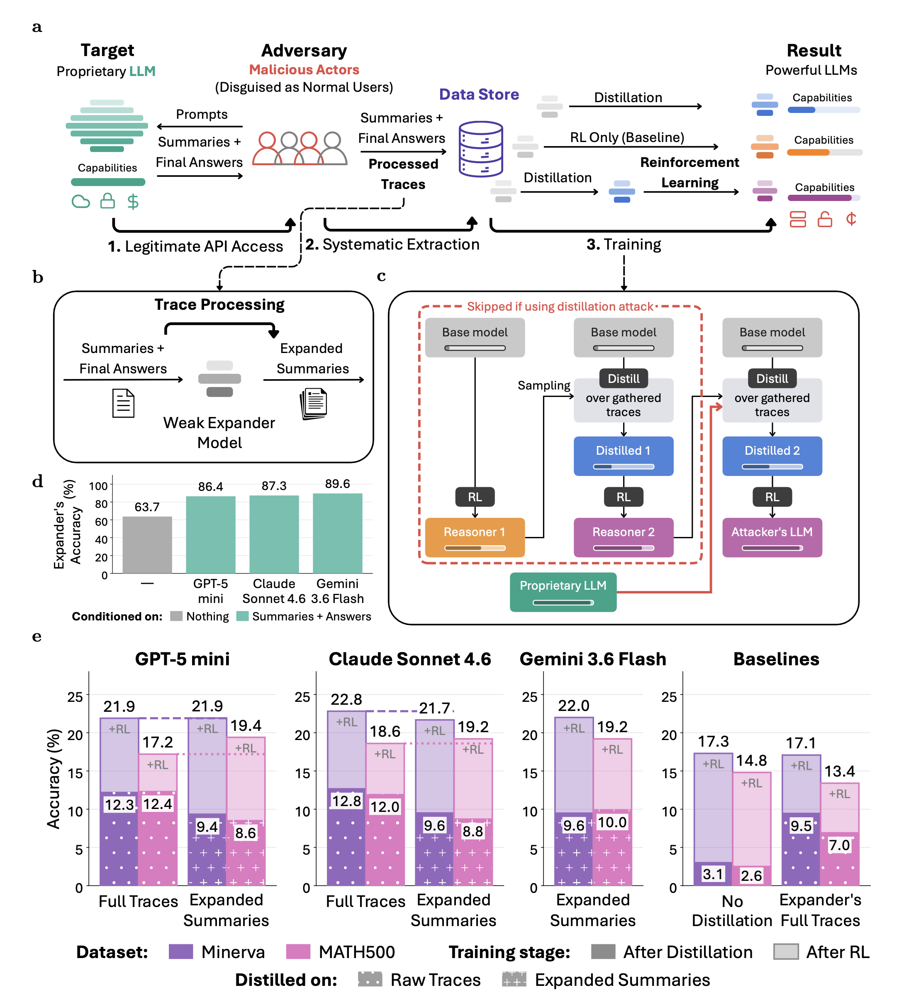

# A New Threat Model for Stealing Proprietary Language Model Reasoning 
_Codename Treason: s**T**ealing **Reason**ing_


TL;DR - realistic distillation attacks pre-process reasoning traces before distillation, and train models further with reinforcement learning after distillation. Existing defenses are shown to be ineffective against the simplest instance of these distillation attacks

**Abstract** -

Distillation attacks steal the reasoning capabilities of closed-source large language models, allowing bad actors to replicate state-of-the-art performance at low cost (Google, [2026](https://cloud.google.com/blog/topics/threat-intelligence/distillation-experimentation-integration-ai-adversarial-use); Anthropic, [2026a](https://www.anthropic.com/news/detecting-and-preventing-distillation-attacks)). Attackers systematically collect a large volume of frontier model reasoning traces and then train (i.e., ``distill'') their own models on these traces. Model providers defend against distillation attacks by obscuring the model's full reasoning traces, instead returning to users only (sometimes altered) reasoning summaries (Anthropic, [2026b](https://anthropic.com/aug-2026-risk-report); OpenAI Developers, [2026](https://developers.openai.com/api/docs/guides/reasoning#reasoning-summaries)). We show that existing defences against stealing reasoning are insufficient -- summaries describe the steps required to solve complex problems, enabling simple methods to effectively reconstruct full reasoning traces. Distilling on this reconstructed reasoning, coupled with subsequent reinforcement learning, allows an attacker to reach capabilities equal to those achieved given full raw reasoning. More broadly, this new threat model implies that any system which leaks sufficient information to reconstruct reasoning traces is likely compromised. Preventing information leakage is likely unrealistic due to its dual use, as withholding information harms benign users and malicious attackers alike. We conclude by advocating for a wider adoption of defences based on multiple rather than single queries (Juuti et al., [2019](https://arxiv.org/abs/1805.02628); Zhang et al., [2021](https://doi.org/10.1145/3474369.3486863); Liu et al., [2026](https://arxiv.org/abs/2606.05725)), which we believe would be more effective against a wide range of attacks on language models (Davies et al., [2026](https://arxiv.org/abs/2602.15001); Davies et al., [2025](https://papers.neurips.cc/paper_files/paper/2025/hash/6ded182245f8e4db3963d2027174133d-Abstract-Conference.html)).





**Figure 1** *- **A threat model for distillation attacks that demonstrates how summaries leak sufficient information to distill reasoning capabilities from closed-source language models.** **a**, Various distillation attack pipelines. Attackers amass large volumes of outputs (reasoning summaries and final answers) from proprietary LLMs and train ("distill") their own models on these outputs. In the proposed threat model, attackers can pre-process outputs and further train distilled models with reinforcement learning. Existing threat models assume attackers train models directly on returned outputs with distillation alone, while a realistic distillation attack likely pre-processes outputs and uses distillation to bootstrap further RL training. **b**, A simple, illustrative example of output pre-processing, where a weak expander model reconstructs full traces by expanding summaries and final answers given by closed-source models. **c**, A frontier LLM reasoning training pipeline, based on the one used for DeepSeek-R1 (Guo et al., [2025](https://doi.org/10.1038/s41586-025-09422-z)). Distillation attacks enable cheaply collecting high-quality reasoning traces, allowing attackers to use fewer rounds of distillation and reinforcement learning. **d**, When conditioned on outputs from closed-source models, a small LLM (the "expander") can correctly answer questions it got wrong previously. **e**, With the attack illustrated here, an attacker's model distilled on expanded summaries approximately matches the performance of a model distilled on the full raw reasoning traces after RL training. Baselines show that accuracy improvements after RL training come from information in the final answers and summaries, not from the weak expander. Full traces were obtained with the extraction attack of Panfilov et al. ([2026](https://arxiv.org/abs/2608.09867)), excluding Gemini models, which had the extraction attack patched when the experiments were performed. Expanded summaries are constructed using information readily available through the model APIs.*


## Table of Contents
- [Running Experiments](#running-experiments)
  - [Setup](#setup)
    - [HPC Cluster (Non-standard Hardware)](#hpc-cluster-non-standard-hardware)
    - [Environment Variables and Versions](#environment-variables-and-versions)
  - [Running Specific Experiments](#running-specific-experiments)
    - [Obtaining Full Traces From an Open-Source Teacher](#obtaining-full-traces-from-an-open-source-teacher)
    - [Distillation](#distillation)
    - [Reinforcement Learning](#reinforcement-learning)
    - [Evaluation](#evaluation)
    - [Pass@k Evaluations](#passk-evaluations)
    - [Obtaining Open-Source Summaries](#obtaining-open-source-summaries)
    - [Obtaining Summaries from Closed-Source Models](#obtaining-summaries-from-closed-source-models)
    - [Reasoning Trace Expansion](#reasoning-trace-expansion)
- [Example with Simple Datasets](#example-with-simple-datasets)
- [Citation](#citation)
- [Bibliography](#bibliography)


# Running Experiments

## Setup

We recommend using an agent to assist in the fast setup of all environments

### HPC Cluster (Non-standard Hardware)

Experiments were run on an HPC consisting of nodes with 4 NVIDIA GH200 Grace Hopper Superchips each. Each superchip pairs a 72-core Arm (aarch64) Grace CPU with an H100 GPU with 96 GB of HBM3 memory.

### Environment Variables and Versions

All experiments use uv to manage virtual environments, which can be installed with the following command (**time: 0-10s**)

```bash 
curl -LsSf https://astral.sh/uv/install.sh | sh
```

All experiments require the `$SCRATCHDIR` environment variable to be set to the storage location on the HPC dedicated to job outputs. In particular: 
- Distilled models are saved to `$SCRATCHDIR/models`
- RL checkpoints are saved to `$SCRATCHDIR/checkpoints`

Scripts to run each experiment are detailed in the next section.

Environemnt versions are managed by uv, and the scripts that run each job. Typical install times vary for each environment, with estimates provided next to each script in later sections. 

- At the top of each script are environment variables that should be set / edited.
- Because scripts were written for an HPC with arm64 architecture, this required compiling many libraries from scratch, increasing install time. Virtual environment setup of each script may need to be modified for different architectures, but library versions should ideally be kept the same. Please use an agent to do this, if necessary. 

## Running Specific Experiments

### Obtaining Full Traces From an Open-Source Teacher

The following script can be used to obtain full reasoning traces from an open source teacher model. The main function in `reason.py` can be edited to change the dataset or prompt used to generate the traces. 

```bash 
# ./treason/scripts/reason.sh <model_name> <output_path>
./treason/scripts/reason.sh Qwen/Qwen2.5-0.5B treason/datasets/medium-1.5B
```

### Distillation

The script `treason/scripts/distill.sh` is used for distillation. By default, distillation is done on the Llama-3.2-3B base model, which can be edited in the script. 

The following command is an example of how to distill the Llama-3.2-3B base model a dataset. Recall that models are saved to `$SCRATCHDIR/models`, and datasets are stored in the `treason/datasets` directory.

```bash
./treason/scripts/distill.sh --dataset dataset_name --output_name Llama-3.2-3B-distill
```

### Reinforcement Learning

The RL framework we use is taken from SimpleRL-Zoo (Zeng et al., [2025](https://arxiv.org/abs/2503.18892)), and slighly modified to work our our arm-64 based HPC cluster. 

The following command is an example of how to do RL on the Llama-3.2-3B base model. The script can be modified or replicated for other base models stored on huggingface. 

```bash
./simpleRL/train_llama3B_rl.sh
```

The following command is an example of how to do RL on a distilled model that has been saved to `$SCRATCHDIR/models`

```bash
./simpleRL/train_local_rl.sh --model_name model_name
```

Checkpoints are saved to `$SCRATCHDIR/checkpoints`. Before evaluation of any checkpoint, the model should be moved to `$SCRATCHDIR/models` 

#### Important ⚠️

- RL scipts are sensitive to library versions, which should not be changed
- A known bug exists when using flash-attention backend with the simpleRL framework. It is set to use an xformers backend - this should not be changed.  

### Evaluation

6 datasets are available for evaluation, based on the the LM-Eval Harness framework (Gao et al., [2024](https://zenodo.org/records/12608602)). The `simple` suffix in dataset names triggers the use of a custom simple prompt reserved for smaller models, following the approach used by Zeng et al., [2025](https://arxiv.org/abs/2503.18892). The datasets with no suffix, or with the `complex` suffix, evaluate models with the complex prompt from the same work.

- `minerva_math` or `minerva_math_simple`
- `minerva_math500` or `minerva_math500_simple`
- `gsm8k-complex` or `gsm8k-simple`

The following command is an example of how to evaluate a remote model on huggingface, like Llama3.2-3B.

```bash
#eval_remote.sh <model_name> <eval_dataset>
./treason/scripts/eval_remote.sh meta-llama/Llama-3.2-3B gsm8k-simple
```
The following command is an example of how to evaluate a model that has been saved to `$SCRATCHDIR/models`

```bash
#eval_local.sh <model_name> <eval_dataset>
./treason/scripts/eval_local.sh Llama-3.2-3B-distill-claude-expand-RL gsm8k-simple
```

### Pass@k Evaluations 

The following command is an example of how to perform pass@k evaluations of any model, whether on hugging face or stored locally on `$SCRATCHDIR/models`. Pass@k evaluations are supported on the MATH500 (`math_500`), GSM8K (`gms8k`)and Minerva (`minerva`) datasets.

```bash
# ./treason/scripts/pass_at_k.sh <path_to_model> <output_name> <dataset_name>
./treason/scripts/pass_at_k.sh meta-llama/Llama-3.2-3B Llama-3.2-3B-math_500 math_500
```

### Obtaining Open-Source Summaries 

Any full traces can be summarized with the following command:

```bash 
./treason/scripts/summarize.sh --model_name Qwen/Qwen2.5-7B-Instruct --dataset_path treason/datasets/open-source-traces --output_path treason/datasets/open-source-summary
```

### Obtaining Summaries from Closed-Source Models
API queries used to obtain summaries and final answers from closed source models are shown below.

#### Claude-Sonnet-4.6

```python
client.messages.create(
    model="claude-sonnet-4-6",
    max_tokens=12000,
    system="You are a helpful assistant.",
    thinking={"type": "enabled", "budget_tokens": 8192, "display": "summarized"},
    messages=[
        {
            "role": "user",
            "content": f"{question}\nPlease reason step by step, and put your final answer within \\boxed{{}}.",
        }
    ],
)
```

#### Gemini Flash 3.6

```python
client.models.generate_content(
    model="gemini-3.6-flash",
    contents=f"{question}\nPlease reason step by step, and put your final answer within \\boxed{{}}.",
    config=types.GenerateContentConfig(
        system_instruction="You are a helpful assistant.",
        thinking_config=types.ThinkingConfig(
            include_thoughts=True,
            thinking_level="high",
        ),
    ),
)
```

#### GPT-5 mini

GPT5 mini summaries and answers were obtained by querying the API with the following command:

```python
client.responses.create(
    model="gpt-5-mini",
    instructions="You are a helpful assistant.",
    input=f"{question}\nPlease reason step by step, and put your final answer within \\boxed{{}}.",
    reasoning={"summary": "auto", "effort": "high"},
)
```

### Reasoning Trace Expansion

The following examples show how summaries in the datasets above can be expanded. All expanded datasets are also saved to `treason/datasets`.

```bash
# open-source summary expansion
./treason/scripts/expand_opensource.sh --dataset_path treason/datasets/open-source-summary --output_path treason/datasets/open-source-expand

# closed-source model stage 1 expansion
./treason/scripts/expand_stage_1.sh --dataset_path treason/datasets/claude-summary --output_path treason/datasets/claude-stage-1

# closed-source model stage 2 expansion
./treason/scripts/expand_stage_2.sh --dataset_path treason/datasets/claude-stage-1 --output_path treason/datasets/claude-stage-2
```

## Example with Simple Datasets

Coming soon! By Nov 22

## Citation
```

```

## Bibliography

Anthropic. "Detecting and Preventing Distillation Attacks." *Anthropic News* (2026a). Accessed: 21 April 2026.

Anthropic. "Risk Report: August 2026." *Anthropic* (2026b). Published under version 3.4 of the Responsible Scaling Policy.

Cobbe, Karl, et al. "Training Verifiers to Solve Math Word Problems." *arXiv preprint arXiv:2110.14168* (2021).

Davies, Xander, et al. "Fundamental Limitations in Pointwise Defences of LLM Finetuning APIs." *Advances in Neural Information Processing Systems* (2025).

Davies, Xander, et al. "Boundary Point Jailbreaking of Black-Box LLMs." *arXiv preprint arXiv:2602.15001* (2026).

Gao, Leo, et al. "The Language Model Evaluation Harness." *Zenodo* (2024).

Google. "Distillation, Experimentation, and (Continued) Integration of AI for Adversarial Use." *Google Threat Intelligence Group Cloud Blog* (2026). Accessed: 21 April 2026.

Grattafiori, Aaron, et al. "The Llama 3 Herd of Models." *arXiv preprint arXiv:2407.21783* (2024).

Guo, Daya, et al. "DeepSeek-R1 Incentivizes Reasoning in LLMs Through Reinforcement Learning." *Nature* (2025).

Hendrycks, Dan, et al. "Measuring Mathematical Problem Solving With the MATH Dataset." *Advances in Neural Information Processing Systems* (2021).

Juuti, Mika, et al. "PRADA: Protecting Against DNN Model Stealing Attacks." *2019 IEEE European Symposium on Security and Privacy (EuroS&P)* (2019).

Lightman, Hunter, et al. "Let's Verify Step by Step." *International Conference on Learning Representations* (2024).

Liu, Shuze, et al. "An Embarrassingly Simple Detector for Model Extraction Attacks in Large Language Model API Traffic." *arXiv preprint arXiv:2606.05725* (2026).

OpenAI Developers. "Reasoning models: Reasoning summaries." *OpenAI Developers* (2026). Accessed: 2026-08-30.

Panfilov, Alexander, et al. "Stealing Reasoning Traces from Proprietary LLM APIs." *arXiv preprint arXiv:2608.09867* (2026).

Qwen Team. "Qwen2.5 Technical Report." *arXiv preprint arXiv:2412.15115* (2025).

Savani, Yash, et al. "Antidistillation Sampling." *The Thirty-ninth Annual Conference on Neural Information Processing Systems* (2025).

Zeng, Weihao, et al. "SimpleRL-Zoo: Investigating and Taming Zero Reinforcement Learning for Open Base Models in the Wild." *arXiv preprint arXiv:2503.18892* (2025).

Zhang, Zhanyuan, et al. "SEAT: Similarity Encoder by Adversarial Training for Detecting Model Extraction Attack Queries." *Proceedings of the 14th ACM Workshop on Artificial Intelligence and Security* (2021).
